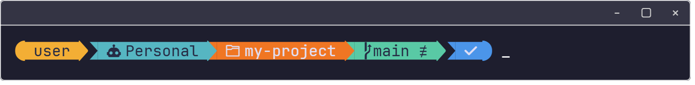
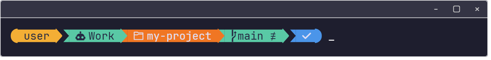

# switch-claude-accounts

Picks the Claude Code account and `GH_TOKEN` per folder, in PowerShell 7 and Git Bash.

- The nearest `.claude-account` file in the current folder or an ancestor decides the account.
  `personal` runs `claude` with `CLAUDE_CONFIG_DIR=~/.claude-personal`; anything else, or no
  file, leaves `CLAUDE_CONFIG_DIR` unset so Claude uses its default `~/.claude` (work).
- The nearest `.gh-token` file sets `GH_TOKEN` before each prompt, and clears it where there is
  none.
- A linked git worktree continues the search from its main checkout, so a worktree created
  elsewhere (for example under `~/.herdr/worktrees`) uses the same account and token as the
  repository it came from. A marker inside the worktree still wins.

## PowerShell 7

Dot-source the script in your profile (`notepad $PROFILE`), **after** any oh-my-posh or
starship init line, because it hooks the prompt:

```powershell
oh-my-posh init pwsh | Invoke-Expression
. "C:\src\switch-claude-accounts\switch-claude.ps1"
```

This defines a `claude` wrapper and `Switch-ClaudeAccount` (alias `use-personal`), sets
`$env:CLAUDE_ACCOUNT` to `Personal` or `Work` before each oh-my-posh render, and sets
`GH_TOKEN` from `.gh-token` before each prompt by wrapping the existing `prompt` function, with
or without oh-my-posh.

### Prompt segment (optional)

`omp-theme.json` is an oh-my-posh theme with a segment showing `CLAUDE_ACCOUNT`, cyan for
Personal and green for Work:





Use it by pointing the init line at it:

```powershell
oh-my-posh init pwsh --config "C:\src\switch-claude-accounts\omp-theme.json" | Invoke-Expression
```

## Git Bash

Source the script from `~/.bashrc`, **after** the oh-my-posh init line if you use one:

```bash
eval "$(oh-my-posh init bash --config 'C:\src\switch-claude-accounts\omp-theme.json')"
source /c/src/switch-claude-accounts/switch-claude.sh
```

This defines a `claude` wrapper and `switch_claude_account [personal|work]` (alias
`use-personal`), and before each prompt sets `GH_TOKEN` from `.gh-token`. With oh-my-posh it
does that in oh-my-posh's `set_poshcontext` hook, after the exit status is captured, and exports
`CLAUDE_ACCOUNT` for the theme's segment, as in pwsh. Without oh-my-posh it adds itself to
`PROMPT_COMMAND` and prefixes the prompt with `Claude: Personal` or `Claude: Work`. The lookups
run in pure bash with no subprocesses, because they run before every prompt.

If Git Bash warns on start that it found `~/.bashrc` but no `~/.bash_profile`, it creates a
`~/.bash_profile` that loads `~/.bashrc`, and the warning does not come back.

## Using it

1. Mark a folder: `use-personal` writes `.claude-account` containing `personal` there, and
   every folder below it follows. `Switch-ClaudeAccount work` (pwsh) or
   `switch_claude_account work` (bash) writes `work`, which overrides a `personal` marker
   further up.
2. Log in to the personal account once, from a folder marked `personal`: run `claude`, then
   `/login`. Its settings live in `~/.claude-personal`.
3. Put a token in `.gh-token` in the folder whose subfolders should use it. Keep both files out
   of version control.

Open shells pick up a change to either script after `. $PROFILE` or `source ~/.bashrc`. A
running Claude session keeps the account it started with.

## License

MIT. See [LICENSE](LICENSE).
